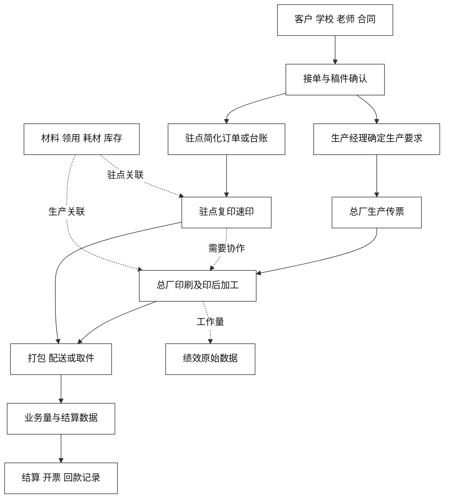

# 印刷厂 ERP 全局需求梳理

整理日期：2026-10-20。用途：把现有需求稿、会议沟通、传票样本放在同一张业务地图上，作为后续沟通入口。本文件是需求整理稿，业务方尚未逐条复核，不是正式规格、开发排期或验收通过记录。

配套文件：[待确认问题清单](待确认问题清单.md)、[资料索引与证据](资料索引与证据.md)。原始资料保持原样。

**当前工作入口：[生产传票分类与录入导出梳理](生产传票分类与录入导出梳理.md)。** 用户进一步明确，本轮只考虑生产传票，先把分类、录入字段和后续导出方法讲清楚。下文完整业务地图继续作为背景，不要求当前同步展开。

**2026-10-21用户再次明确：这批传票只用于了解业务、设计后续传票录入，不处理该批数据，不做逐张录入、补齐、清洗或整批结算。老师姓名缺失时允许暂空。纪要中的试录路线保留为历史沟通，不作为当前任务。**

使用场景已确认并进一步说明（2026-10-21）：由夏负责日常录入，电脑端和手机端均需支持。现有已开好的传票用于分析字段；未来由夏根据实际业务直接在系统录入，不先开纸票再补录。具体交互和技术形态仍在方案讨论阶段，录入后是否打印另行讨论。

2026-10-22录入方式调整：删除票头统一学校、老师，各印刷品明细分别选择已有学校及该校老师；学校、老师档案的增删改查放到后续后台，取消随传票自动新增档案。当前只更新需求与演示，后台尚未实施。

同日进一步明确，上版说明、上版才数、上版次数、印法、色别、机印张数放在对应印刷品明细下单独填写，仍为选填、后续可修改；不再在整票公共区域统一填写工艺。

预计用纸的关联方式也已确认：每条记录独立多选对应印刷明细，同票内每项明细最多关联一条预计用纸；已占用的明细在其他用纸记录中禁用，取消原勾选或移除用纸记录后恢复可选。用纸及关联仍为选填，共用用纸只计一次。

## 一 当前最需要统一的认识

**2026-10-20 用户已明确：当前推进方向主要以 [meeting-notes.md](../../metting/meeting-notes.md)、[meeting-notes.json](../../metting/transcripts/meeting-notes.json) 和 [传票合集](../../传票/传票合集/) 为依据。** 这项优先级已确定，不再把“选择七模块整包还是生产票起步”作为当前前置问题。

**新增沟通纪要曾提出生产票试录、汇总及结算数据整理的落地路线。** 其中讨论了文颖试录、夏经理继续手写、后续再电脑开票及针式打印等顺序，学校自主下单和车间电子流转等功能后置，见[E01](资料索引与证据.md#e01)。用户最新明确，当前先用样票理解业务、确定未来录入及导出规则，不启动该批试录或结算整理。

后续系统的用途包括：知道每个学校生产了多少、预计用了多少纸、花销多少，并导出所需数据。JSON `seg_0050`、`seg_0065—0066` 表达了这类用途；当前要讲清它们需要什么录入字段和输出规则，不是计算本批业务结果。

完整 ERP 的客户与合同、生产、驻点、材料、配送、财务和工作量等内容继续保留为业务背景与后续需求。2026-09-26 七模块报价草案的 64,000 元及目标工期只保留作历史参考；当前生产票这一步的具体费用、两端实现方式和输出细则另行确定，不用整包范围阻挡样本梳理。报价原貌见第十节。

### 1.1 本次整理采用的状态

| 状态 | 含义 |
|---|---|
| 近期共识 | 新增沟通记录中明确采纳的当前方向，仍需核实具体字段和输出口径 |
| 历史业务事实 | 过去会议对现实工作方式的描述；人员、规则仍可能变化 |
| 历史目标或设想 | 已讨论但没有证据表明属于当前第一步的功能 |
| 待确认 | 原文不明确、相互冲突，或只有提问和推测 |
| 整理建议 | 本次为便于后续沟通提出的组织方法，不代表业务方已批准 |

新增纪要标有 **2026-10-19 的生成时间**，没有明确会议发生日期；不把生成日期写成会议日期。当前资料优先级来自用户最新指定，不依赖推测会议与报价稿的时间先后。

### 1.2 三块主要资料各自说明什么

| 主要资料 | 对当前工作的作用 |
|---|---|
| `meeting-notes.md` | 快速查看已讨论的分步方案、人员和行动项 |
| `meeting-notes.json` | 用 172 段原转写核对范围、先后和未定项；同一记录不同格式不算两份独立证据 |
| `传票合集` 中的 PDF／图片 | 解释真实票面、明细、手写数量和算式，是当前录入内容的实物依据 |
| 合集内的解析 JSON／CSV | 现有识别候选，帮助定位和盘点，仍需回图及业务核对；与上面的会议 JSON 性质不同 |

眼下工作落点是借典型生产票理解业务，通过对话整理分类、后续录入字段、计价及导出草案。不安排本批试填、补数或逐票复核，也不等待完整ERP规则先确定。

### 1.3 当前资料与项目状态

- 现有资料包括根目录 4 份需求 Word、1 份会议疑问清单、会议 1—5 的 10 份纪要、会议 1—6 的 8 份原始转写，以及新增沟通的纪要和转写。
- 另有 3 版早期对话整理、全局思维导图、生产台账照片、传票扫描及图片、现有离线解析、历史开源候选清单。
- 本轮又纳入 `03_需求/功能清单与报价/` 的 10 份 Markdown，以及 `现状业务流程_AS-IS/` 的 6 份实质性调研／参考文档；后者另有 3 份 0 字节占位文件。
- 当前目录以需求和样本资料为主；本次盘点发现的既有程序仅为传票解析结果生成脚本，没有据此证明 ERP 业务系统已实现。
- 现有协作文件出现 CRM 专用的 Spec、21 个 Agent 工具、后台交付和其他目录引用。这些内容与 ERP 资料不相符，不能拿来约束 ERP 业务范围。本次按用户授权跳过失效的 Comet 入口，未修改这些规则。

## 二 企业业务与真正要解决的问题

### 2.1 企业与客户

主营场景是面向学校的试卷、答题卡、成册及其他印刷服务，既有总厂生产，也有校内驻点复印、速印。会议还涉及石化等企业客户、散客、材料流转、废纸等内部经营记录。

早期会议提到两家公司分别承接合同、使用各自账户与发票，共用实际生产场地及部分材料。纪要中公司名称有“晶晶／金金／津金”等异写，新增调研使用“津金印刷、吉星彩印”；法定名称、合同主体、实际生产主体及内部结算关系仍需用原件确认。票面可见“吉星印刷厂作业传票”及企业印章，但不能据此自动合并所有公司主体。见 [E03](资料索引与证据.md#e03)。

学校通常先获得印刷服务，再在财政资金安排后结算，工厂存在垫资压力。学校的合同额度、实际业务量、已结算金额、已开票金额和已回款金额并非同一回事。

### 2.2 核心痛点

| 痛点 | 当前表现 | 系统希望改善的结果 |
|---|---|---|
| 重复录入 | 接单记一次，开传票再写一次，结算时再录一次 | 同一生产信息能够复用，减少重复抄录 |
| 票据混杂 | 连续票号混有生产、材料、废纸等用途 | 先准确识别生产票，再汇总学校业务 |
| 结算整理费时 | 人工按学校、时间、规格重新归类和计算 | 能追溯到原票、核对数量和金额、形成可用结算数据 |
| 实物与数据难对应 | 稿件、样稿、纸票、包装和最终台账分别流转 | 保留清晰的对应关系，减少漏单、重复和错归学校 |
| 总厂与驻点不透明 | 驻点主要按阶段报总量，耗材和实际产量难核对 | 后续逐步看到业务量、耗材和库存之间的关系 |
| 业务依赖个人经验 | 规格换算、特殊定价、排产等集中在少数人员 | 先记录清楚原意和核算过程，再讨论自动化 |
| 操作接受度有限 | 工人习惯纸票，复杂流程增加负担 | 先让少数岗位用起来，再逐步改变生产操作 |

近期最直接的价值是由夏一次录入生产信息，后续复用于查询、学校汇总和导出，减少重复抄录。完整工序跟踪、库存自动减扣和工资核算的价值保留在全局目标中。

## 三 人员与职责

以下是资料中的业务分工，尚未形成系统权限矩阵。历史人名和现任分工须分别看待。

| 角色 | 资料中的职责 | 与当前第一步的关系 |
|---|---|---|
| 刘总／厂方负责人 | 确认方向、取舍、人员配合及最终业务口径 | 确认生产票范围、样本与输出是否可用 |
| 沈老师／技术方 | 梳理流程、解释字段、设计录入方式及处理输出 | 接收样本、追问含义、整理录入与结算口径 |
| 文颖 | 新增沟通中接手相关商务／结算工作，并曾讨论承担试录 | 属于历史路线中的试录人；当前不安排本批试录 |
| 夏经理／生产经理 | 开传票、生产要求、报价及现场协调 | 用户最新明确未来由夏根据实际业务直接在系统录入，电脑和手机均需支持 |
| 原商务／结算岗 | 对接学校电子稿、合同和结算整理 | 历史分工；不能继续默认原人员都在现场执行 |
| 设计／排版岗位 | 调整稿件、处理设计及印前文件 | 与商务沟通和生产要求衔接，具体修改边界仍待确认 |
| 学校老师、学校指定联系人 | 提交需求、确认稿件、接收印刷品；学校汇总用量 | 当前提供业务归属和结算信息；不要求自行进入新系统下单 |
| 库管 | 备料、领发料、库存记录 | 历史目标相关岗位，当前不改变工作方式 |
| 印刷、切纸、装订、打包人员 | 按纸票生产，历史规划中希望记录工作量 | 当前继续纸票流转 |
| 司机／配送 | 取纸质稿、配送、拍照留证 | 当前不增加电子操作 |
| 财务人员 | 学校对账、开票、收付款及工资资料 | 需提供结算样例、主体和金额口径；不等于本步建设完整财务系统 |
| 驻点人员 | 现场接单、排版校对、复印速印、记录用量 | 留作全局业务背景，当前不新增驻点系统要求 |

早期“小丽”是对商务岗位的代称，不宜直接写成现任人员。两位“周老师”可能分别指财务和驻点人员；“杜老师”与“文颖”也不能仅凭名字联想合并。原转写的说话人标签仅在各自文件内有效。

## 四 当前第一步及后续演进

### 4.1 纪要中讨论过的落地路线

当前处于需求梳理阶段，下图仅保留历史会议路线。用户已明确未来由夏直接在系统录入，下图中的先开纸票、文颖试录不作为当前录入方案。

这是对历史沟通内容的整理。订货日期等本轮已确定规则以生产票专稿为准；电脑和手机均需支持的要求已确定，两端具体实现、页面及导出版式继续讨论，图中的核对和试录不作为当前待办。

### 4.2 阶段边界

| 步骤 | 已有沟通方向 | 前提与尚未确定的部分 |
|---|---|---|
| 当前：需求梳理 | 用样票理解传票与产品构成，确认未来录入字段、计算及导出规则 | 不处理本批数据，不以补齐样票或生成结算结果为标准 |
| 曾讨论的旧票试录（当前不执行） | 文颖录入旧票，再核对学校统计和结算数据 | 保留为历史路线；本轮未启动批量试录 |
| 后续系统使用（录入方式已明确） | 夏根据实际业务直接录入生产传票，电脑和手机均需支持，不先开纸票再补录 | 当前仍在需求与方案讨论，未进入实施；录入后的打印要求、模板和设备另定 |
| 后续逐步接入完整 ERP | 订单形成、客户服务、生产、驻点、材料、绩效等逐步叠加 | 没有统一批准的范围、顺序、价格和排期 |

本阶段明确暂放一边的内容有：其他类型传票的业务系统化、学校自主下单应用、车间工人电子取单与扫码、生产全流程接入，以及口述／AI 自动录入等复杂功能。资料和需求继续保留，不等于永久删除。

“形成结算数据”也不能自动扩展为税务开票接口、在线支付、银行回款自动核销或完整财务核算。近期需要的是先讲清楚结算信息应当怎样整理。

## 五 完整 ERP 的业务地图

本节保存长期需求全貌。除当前生产票、试录和结算数据所需内容外，其余均不据本次整理自动进入实施。

图中箭头描述业务关联，不规定数据库结构、自动触发时机或严格一对一关系。

### 5.1 客户与合同

历史稿件覆盖学校、企业客户和散户；学校业务又有招投标、框架合同等形式。合同希望记录主体、期限、额度、分品类单价和原件附件。

会议 3 曾形成“一订单归一合同，跨合同内容拆单”的方向，同一学校可有多个品类合同。合同空档期、临时合同、跨年度结余及真实业务与合同品类之间的关系仍有问题。当前试录至少要能认清业务属于谁；是否立即建设完整合同模块尚无近期授权依据。见 [E04](资料索引与证据.md#e04)、[E10](资料索引与证据.md#e10)。

合同不能一律套用学校模式。现场将学校描述为金额合同，实际印量随需要发生；石化等企业合同则对分品项数量和单价约定更严格，按客户需要多次交付。早期资料曾按纸型数量讨论总校用量，适用合同及统计口径需要分别看。[E05](资料索引与证据.md#e05)

### 5.2 接单与稿件

历史接单方式包括微信群发电子稿、司机带回纸质稿、驻点现场收纸稿或申请单、工厂内部代录，以及远期老师自助下单。

早期目标是电子稿先商务确认、再由生产经理转为生产要求；纸稿可由工厂代录并关联实际老师。驻点通常能自行完成简单业务的校对与印刷，不必先经过总厂。纸稿扫描不等于自动形成准确的结构化订单，后者需要人工确认字段和业务含义。

稿件“修改”究竟指版式／内容调整还是只审核、通过微信还是系统沟通、由哪个岗位在电脑或手机操作，仍未完整确认。这些原黄色问题继续留在后续对客流程中。

### 5.3 生产传票

传票承担“把需求变成现场可执行信息”的作用。纸票有连续编号，记载客户、日期、产品、规格、工艺、制版、机印张数、材料、装订、备注等。

**相同票面也被用于非生产事项。** 不能凭“吉星印刷厂作业传票”标题、票号或盖章判断它必然是学校生产订单。当前先明确生产票筛选和一票多行如何录入。将来再讨论自动生成、修改、作废和打印。见 [E02](资料索引与证据.md#e02)、[E12](资料索引与证据.md#e12)。

会议 5 的现场访谈进一步明确，一张生产传票可能合放多个订单或产品，甚至分属不同学校、合同和签约公司；同票也可能有的明细需要装订、有的不需要。合在一张纸上是现场组织方式，不能因此合并学校、合同或财务归属。见 [E07](资料索引与证据.md#e07)。

新增订单调研还明确，现实并未证明每笔需求都有独立电子订单，也没有稳定独立的排产台账。因此旧票整理应先保持原票和明细可追溯，不能要求旧票先具备未来系统的订单号、工序号或批次号。已有生产台账照片的使用岗位、时期和用途仍需核实。[E17](资料索引与证据.md#e17)

### 5.4 总厂生产与排产

涉及速印、复印、胶印，以及备料、裁切、刷胶、装订、打包等不同组合。现场澄清的常见成品流程是普通产品“印刷→裁切→打包”，需装订产品“印刷→装订／胶装→裁切→打包”；印前大纸裁切与印后成品裁切也要区分。不能硬编码成所有产品唯一顺序。

历史设想包括标准工艺模板、经理调整流程和排序、工人按岗位认领、完工记录、加急提示。现场主要仍依赖纸票，新增沟通也明确先保留纸票生产方式。个人锁单、多人协作、批次接续及责任量的规则仍需现场确认；生产票试录方案不连接这些流程，七模块报价则将其列入基础范围。见 [E06](资料索引与证据.md#e06)、[E07](资料索引与证据.md#e07)。

### 5.5 打包与交付

包装需要区分学校、校区、年级、学科、老师等信息；现状通常送到收发室或约定地点，拍照发群，可能由学生代取。打印包装标签、老师查照片和进度属于历史服务目标。

“已送达”“已取走”“老师签收”“财务可结算”不能未经确认合并成一个状态。配送可能分批，谁在系统确认最终送达尚未统一。见 [E08](资料索引与证据.md#e08)。

### 5.6 驻点

驻点一般服务绑定学校，少量人员处理简单复印与速印；普通业务原本不使用总厂四联传票。需要复杂装订、答题卡等能力时，可由总厂全部承做，或驻点印刷后交总厂加工，也可能分别生产后合并交付。

驻点管理诉求包括学校用量、机器计数、纸张和油墨／版纸消耗、补给与库存对比。会议 6 补充了现场计数和登记方式。订单、机器产量与耗材之间的差异是管理线索，不能不考虑测试、废张、计数单位便直接当作可扣款损耗。当前不建设驻点电子流程。见 [E11](资料索引与证据.md#e11)。

### 5.7 材料、采购与外协

历史目标包括总厂和驻点材料台账、进出库、领料、补料、退料、库存与耗材监管。现实同时有整包成品纸和大纸裁切，规格、开数、份、张、面、包等单位需要解释。

外协可能是半成品送回总厂再组装、打包、配送；是否扣厂内库存、如何区分外来材料以及材料所属公司尚未确定。历史对“库存跟单自动减扣”的表述不足以确定扣减时点和算法。当前纸票中的材料信息可以先保留原意，不应自动变成库存流水。见 [E09](资料索引与证据.md#e09)。

### 5.8 计价与结算

这是近期最相关、也最容易误解的部分。

- 合同内规格原则上按该校合同单价计算；合同外产品常由生产经理人工核算和协商。
- 计价单位尚有资料差异：早期会议提到合同按张／按面不一，会议 5 的学校现场口径又是按张、单面双面均一张。应以对应真实合同确认适用范围，不默默统一。
- 会议存在实际产品与账面品类不同、实际数量与计费数量不同的描述，例如特殊工艺通过增加计费数量覆盖成本。它们是需核实的业务现象，不能据此直接固化折算算法、用账面品类计算耗料，或默认可对外隐去真实业务。
- 稿件提出保留系统实际业务明细与人工调整后的结算明细；两者关联、修改理由、对外表述和确认责任仍待确定。
- 学校可按非自然月区间结算；同一业务多次结算、多个结算单合开发票、部分回款、预付款和跨年结余均有讨论或冲突。
- “导出结算表”与“开出税务发票”“收到款并核销”是不同动作；没有依据将其统一为一个完成标志。

新增结算调研澄清，会计口中的“结算单”有时就是实际印刷明细，未证明现场另有统一、独立的结算单。先定义当前要输出的数据，不预设必须新增一套单据审批生命周期。

还存在先开票或结款、后补足生产的情形，例如实际做了约 5 万元而先按 7 万元办理阶段开票。实际生产、已开票、已收款与待履约差额需分别表达；不能补造差额生产票，也不能把“已全额回款”读成“所有生产已完成”。主文流程图只表达通常业务关系，不设“全部送达后才允许所有财务动作”的硬前置。[E18](资料索引与证据.md#e18)

当前必须先获得一份实际可用的学校结算样例，并确认每一项如何从生产票得出。具体问题见 [Q06—Q08](待确认问题清单.md#当前优先确认)。证据见 [E05](资料索引与证据.md#e05)、[E10](资料索引与证据.md#e10)。

现场访谈还相对明确：一个合同可分多次开票，一张发票不跨多个合同，一个结算明细可拆成多张发票；多个结算明细是否合成一票仍缺清晰答复。财务另提出应收、应付、学校预收、供应商预付，以及工资、维修、水电、材料等日常收支记录。这些属于长期财务需求，不能把近期“结算数据整理”扩成完整往来账工程。

### 5.9 成本、利润与工作量

长期希望看到订单售价、材料成本和毛利，以及员工完成了哪些业务、多少张数、转数或装订量。早期已接受“先给工资核算人员提供工作量原始数据”的简化方式。

完整工资、考勤、加班、净利润等主要来自完整方案或愿景，不能当当前承诺。材料成本、人工、水电、外协、运费的归集方式没有形成统一口径；不能拿“售价减纸张成本”直接称为净利润。

### 5.10 终端与权限

历史三端为内部网页、学校小程序／网页、企业官网；工位电脑、扫码枪、标签机和针式打印机也分别讨论过。学校端隐藏内部成本与利润、车间不看商务价格、学校之间数据隔离是共同诉求。

但驻点人员是否接触金额、学校不同管理层能看多大范围、两家公司数据如何分开仍需核实。用户于2026-10-21确认，未来由夏根据实际业务直接在系统录入，电脑和手机均需支持，具体技术形态另定；“小程序录入”是历史选项，不能自动理解为学校自主下单端。

### 5.11 周边功能与使用条件

资料还保留企业官网、合同附件归档、消息提醒、员工手册与培训学习区、公告／光荣榜，以及操作日志、导出等诉求。设备方面另有报修申请、维修工单／配件记录、维修人员工作量诉求，不能只归为一项维修费用。它们的来源和分期各不相同，不宜因为未进入主流程就丢失，也不能自动加入生产票试录。

附件保存、备份、历史更正和操作权限的具体要求，需要在确定录入载体时一起说明。本轮没有已定技术栈或部署环境；新增报价有目标工期测算，尚非批准后的交付承诺。

## 六 业务对象与术语

以下仅用于沟通，尚不等于已批准的数据表。

| 对象 | 要表达的业务含义 | 不能提前作的假设 |
|---|---|---|
| 公司主体 | 合同、发票、收款或实际生产所属主体 | 所有资料只属于同一公司 |
| 学校／客户 | 业务及结算归属，可涉及校区等层级 | 票上简称天然等于唯一客户 |
| 老师／联系人 | 实际需求人、代办人、收件人 | 录入人就是下单老师 |
| 合同及价目 | 客户约定的品类、期限、价格与额度 | 合同额度就是实收余额 |
| 订单／印刷需求 | 一项客户需求及其确认内容 | 与一张纸票或一行明细总是一对一 |
| 学校印刷申请单 | 学校侧同意或核对印刷的条子，可事后补齐 | 与订单一对一，或存在统一唯一编号 |
| 生产传票 | 指导生产并记录业务的单据 | 所有同版式票均为生产票 |
| 传票明细 | 一张票中的产品、工艺、材料等多行内容 | 一行只能对应一个老师，或一票只有一个产品 |
| 实际数量 | 实际印刷、生产、配送等数量及单位 | 等于账面计费数量或机器计数 |
| 计费数量 | 据约定价格核算的数量及单位 | 可以不记录来源和确认依据 |
| 生产与配送批次 | 同一任务分次处理和交付 | 分批一定拆票，或一定无须记录 |
| 结算明细／结算单 | 某次对账结算所采用的业务、数量、金额 | 与订单、发票严格一对一 |
| 发票 | 实际开票凭据及其主体、金额 | 已开票就是已收款 |
| 回款／付款 | 实际收付及其对应业务 | 学校预付款与付供应商预付款同义 |
| 解析候选值 | 从照片阅读得到的待核数据 | 已经过业务方确认，可以直接入账 |

生产订单、学校申请单、传票和结算之间的准确关系，需要用真实样票串起来。疑问清单对学校申请单存在双向多次关联、无唯一号的回答；不能把它当作总厂传票的同义词。五份 Word 中未找到“委印单”的独立明确定义，如后续使用此词，应先说明指哪种单据。

`传票_016` 可见同一票面有多科目及分校分发记录，说明至少不能只按“一票一个简单标题加总金额”理解样本；最终拆分方式仍需确认。

## 七 现有传票能支持什么

### 7.1 资料数量与可靠性

当前有 119 张编号传票图片。解析资料在整理期间由外部继续补充；**2026-10-20 10:35（北京时间）的核验快照**已覆盖 001—119，共 119 份逐票 JSON，并有汇总文件和生成脚本。**解析文件覆盖全部图片，不代表生产票分类、识字和金额已经核对通过。**

两轮目视抽查覆盖 001、012、016、025、033、050、051、056、064、091 等代表票，另查看全局思维导图和生产台账照片。未重新识别全部图片，也未重新运行生成脚本。

抽查发现：

- `012`、`025`、`050` 票面均可见废纸内容，现有 README 却将其描述为内部领料类；`050` 可读到“废纸：82斤”。另一行收费内容仍需现场确认。
- `033` 可见印刷工艺、机印张数等栏内内容，不能仅按 README 的“领料类”说明将其排除为非生产票。
- `016` 明细密集，含分校、数量、包装和金额计算；现有解析也列有不确定项。
- `051` 可见多科目印刷要求及手写计算，README 却将其列为领料／切纸类；`064` 可见废纸和复印费，解析又写成信纸／复印单。当前生产票筛选必须回看实际用途。
- `056` 存在多科目、单双面、机印张数及涂改，共享材料记录不一定逐行对应；`091` 的解析数量和算式又存在不一致，不能直接当成票面计算错误。
- 多票存在划改、印章覆盖、空白金额和手写计算。不能自动把空值补为零，也不能凭“现金收讫”印章推导所有明细已经核销。

因此，现有解析适合作为字段盘点线索和待核候选，下一步仍需回到原票分类、认字和确认含义。上述问题本次仅登记，未改动原解析结果。见 [E12](资料索引与证据.md#e12)。

### 7.2 已看到的字段与仍需解释的内容

| 信息组 | 票面或台账已有内容 | 当前需说明的问题 |
|---|---|---|
| 识别与来源 | 票号、票面图、部分手写序号 | 票号与图序号如何对应；重号、缺号、重扫怎样识别 |
| 客户与人员 | 订货单位、品名栏中的老师／用途、部分联系电话 | 简称、校区、老师混写怎样拆开；一票多归属怎样汇总 |
| 日期 | 订货日期、取货日期、额外“某日送到”备注 | 填写含义及统计采用哪一个日期，空白怎么处理 |
| 产品与工艺 | 产品名、纸张规格、单／双面、色别、装订要求 | 原文含义、数量单位、特殊产品和工艺组合 |
| 制版与生产量 | 上版说明、上版才数、上版次数、机印张数 | 与客户张数、页数、面数、机器转数的关系 |
| 材料 | 原材料名称、规格、数量、单位 | 是计划量、实领量还是折算量；损耗如何包含 |
| 金额 | 明细金额、手写算式、合计、盖章 | 哪项是最终应收；涂改前后取哪项；单价来源 |
| 包装与附注 | 分发清单、袋数、交期、前单关联 | 属于当前票、其他票还是配送记录；是否影响计价 |

这些是字段盘点，不是要求文颖立即填写全部字段。现已据票面形成[字段与导出草案](生产传票分类与录入导出梳理.md)，不明确的含义标待确认；用样本边解释边修订，不把识别错误固化为正式列定义。

### 7.3 当前候选数据距离结算输出还差什么

针对上述 001—119 快照的只读统计：119 份 JSON 包含 499 条 `items`，499 条行金额 `amount` 全为空；只有 7 张票的 `total_amount` 为非空文字，其中还有存疑、覆盖或附注；119 张均有 `uncertain`。这些是识别文件的覆盖情况，不代表原票实际没有金额。

这批数据能帮助列出产品／规格、找到手写算式和选取典型票，但尚不能直接输出可靠的完整学校结算金额。需要把原票、归属、真实数量、计费数量／单位、价格来源和最终确认金额接起来；已有算式应保留原文，逐步确认含义，不把所有数量混成一个数。

汇总文件以明细行为单位，同票合计会在多行重复，不能直接对合计列求和。图片序号也不同于票号；解析中的跨批次“缺号”可能只是排序错位，是否缺票须看整批对应关系。见 [E21](资料索引与证据.md#e21)。

## 八 跨资料变化与冲突

| 议题 | 资料中的差异 | 本次整理口径 |
|---|---|---|
| 首期范围 | 早期完整 ERP；新增沟通只取生产票与结算数据 | 用户已指定后者代表当前推进方向，完整需求作为背景和后续需求保留 |
| 报价范围 | 9 月 26 日报价把七模块、全部已知票种与扫码生产列入一期基础 | 当前不套用整包范围、总价或工期；费用按这一步的实际工作内容再确定 |
| 接单端 | 早期希望学校小程序；方案又提供网页备选 | 当前不做学校自主下单端；未来由夏直接在系统录入，电脑和手机均需支持，具体实现方式另定 |
| 价格预估 | 方案有老师下单预估额度；会议 2 提出无需前端预估 | 不把客户预估价格作为既定首期需求 |
| 合同量和单位 | 前期有纸型数量、张／面口径；现场又说学校金额合同、单双均按张 | 逐合同确认，石化的品项数量合同另看 |
| 工序操作 | 历史目标为逐工序认领完成；现场主要依赖纸票 | 生产票起步方案先保留纸票生产，七模块报价则包含扫码和报工 |
| 工作量现状 | 调研写人工记量及离岗前／补录；会议 5 接替场景又说不记分段量 | 区分票级统计、个别工序和逐人分量，不认定已有稳定逐人报工制度 |
| 加急 | 会议 2 尾部提到老师自选；会议 3 明确由生产经理标记 | 保留后者作为历史收口，当前无须增加教师加急入口 |
| 生产后修改 | 中途发言说不能改；随后允许经理修改并留备注 | 不把中途表达写成硬锁规则；更正和计费仍需结合原票确认 |
| 合同额度 | 稿件有提交即扣；总体稿和会议有先冻结、送达再正式消耗 | 记录分歧，现金、额度和结算状态分开理解 |
| 多次结算／合票 | 不同稿件和回答对订单多结算、多个结算单合票表述不一 | 不建立一对一约束；拿实际案例确认 |
| 合同结余 | 纪要写“作废”；原话包括按实际结或全结后留作次年使用 | 不能默认跨年余额清零 |
| 预付款 | 一处指学校预付工厂；另一处转为工厂付供应商 | 分清收款与付款方向后再定义 |
| 旧单补录和批次 | summary 给出肯定结论，原话仍是建议或等生产经理回复 | 保持待确认 |
| 数据解析 | README 的票种判断与部分原图冲突 | 图片和业务方确认为准，保留原解析供追溯 |
| 调研流程图 | 部分图仅画履约后结算、款齐即结清；文字另有先开票后履约 | 不能把通常路径画法升为全部场景的硬约束 |

详细定位见 [资料索引与证据](资料索引与证据.md)。尤其不能把 detail 中“系统已经实现／已打通”的叙述当开发证据：原话有些是在描述未来期望。

## 九 下一次沟通应先解决什么

当前方向已由用户明确：样票用于理解未来怎样录入和导出，参见问题清单中的[Q01—Q10](待确认问题清单.md#当前优先确认)。不处理本批业务数据，也不重新选择整包范围。

建议围绕现有样本核实以下内容：

1. 只在需要说明业务结构时使用典型样票，理解一票多产品、产品内部构成及共享生产记录。
2. 固化已确认的学校、老师、数量单位和金额处理规则，继续讨论确实影响录入的字段。
3. 按已确认的订货日期及学校／老师等范围，讨论未来导出所需列和版式。

分类、字段和导出草案已单独整理。样票中的姓名辨认、漏记用纸和逐票账目不列为当前补齐任务。接下来按夏直接在系统录入的方式细化录入方案及导出样张；传票打印、生产、库存、驻点、完整财务及客户端等其余问题在相关阶段再讨论。

## 十 新增目录与报价口径

### 10.1 三类资料分别回答不同问题

| 资料组 | 作用 | 与其他资料的关系 |
|---|---|---|
| 会议原话、票据和现场样本 | 说明真实业务、限制与个别明确答复 | 用于核对调研和功能设计，仍有转写／字迹误差 |
| `现状业务流程_AS-IS` | 组织订单、生产、驻点、结算流程和待确认问题 | 调研文档主动区分现状与拟建规则，部分段落仍混有设计；不是现场系统已实现的证据 |
| `03_需求/功能清单与报价` | 把目标能力拆成八个报价单元、基础项、增强项与依赖 | 是 2026-09-26 的讨论／评估稿，客户版也未证明已签约；不能反过来证明业务规则已确认 |

`纸质稿订单流程.md`、`总厂生产流程.md`、`外围驻点流程.md` 当前均为 0 字节；实质内容在各业务调研文件里。外部“新干线”商品与下单研究为竞品／供应商页面参考，不能当成本厂已确认的商品目录和计价算法。详见 [E17—E20](资料索引与证据.md#e17)。

两份订单／结算长稿有助于厘清纸票、真实业务明细、申请单、阶段对账及发票的关系，也保留了先开票后补生产的例外。但认领、本人线上确认、配额、阈值预警等仍是历史目标／反馈；总厂调研中的人工工作量描述也与部分现场答复存在差异。本次按来源分别保留，没有把“现状”目录名当成规则已确认的证明。

### 10.2 草案中的模块与金额

以下人民币金额只转述现有草案，不构成本轮新报价。

八个单元合计列有 **100 个基础功能点和 26 个增强功能点**。客户版与内部模块在编号、功能名称、交付范围和金额上相同；它们是同一套报价的不同呈现，不是两套独立采购需求。

| 报价单元 | 草案基础金额 | 草案增强项全选增加 | 与生产票试录方案的差别 |
|---|---:|---:|---|
| 01 基础平台与合同计价 | 6,200 | 1,700 | 完整双公司、合同、角色和计价，当前先核对必要归属／价目 |
| 02 对客下单 | 8,200 | 3,200 | 老师网页、代录、申请单和查询；当前不要求学校上线下单 |
| 03 传票 | 9,000 | 1,300 | 各类票、混合明细、条码；当前只选生产票试录 |
| 04 生产流程 | 13,200 | 1,800 | 扫码进工序、逐人报工、批次协同；当前保留纸票生产 |
| 05 财务与结算 | 14,500 | 2,900 | 业务明细、对账、开票回款、往来和额度账；当前先确定结算输出 |
| 06 库存与耗材 | 11,700 | 4,300 | 出入库、散张、补料、机器计数和差异；当前不建仓储闭环 |
| 07 交付配送 | 9,800 | 3,700 | 包件、配送、自取、凭据和分批；当前不增加车间／司机操作 |
| 08 员工工作量与绩效 | 5,100，整包选配 | 4,400 | 人工工资金额台账与工作量复核；自动计件仍另选 |

前七基础明细合计 **72,600 元**，整包减 **8,600 元**为 **64,000 元**。加 08 基础包为 **69,100 元**；前七基础加其全部增强为 **82,900 元**；八个基础包及全部已列增强为 **92,400 元**。组合优惠只在前七基础整包选择时计入一次。

### 10.3 计价 工期与依赖

草案按“原估人日 ÷ 3 × 300 元／计价工作日”列分项金额；前七基础原估 726 人日、计价 242 工作日。工期却另按 4.8 倍效率、单人每周 7 天连续投入计算，所以得到约 151 天、约 5 个月。**3 倍是计价口径，4.8 倍是另一个未经逐项验证的排期假设，不能混为同一个工作量承诺。**

增强功能之间有前置依赖，例如材料毛利依赖材料成本、质量奖惩依赖质量责任记录、维修绩效依赖维修工单；不能只勾最终功能而漏掉前置范围和价格。08 基础是人工金额台账，不包含自动计件工资。

税费、部署运维、第三方服务、设备耗材、迁移、培训、验收与变更等商务条件仍需另行确定。客户版主要隐藏估工细节、保留功能与金额；本轮没有证据表明客户已勾选全部内容、接受目标工期或批准固定总价。[E20](资料索引与证据.md#e20)
