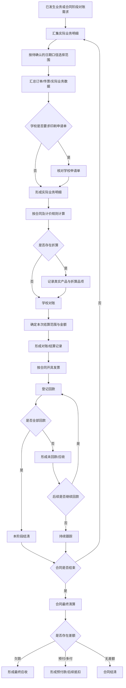

> 文档定位：业务调研 / AS-IS；拟建规则单独标注  
> 项目：印刷厂 ERP  
> 调研范围：从纸质传票/驻点记录形成实际业务明细，到学校对账、阶段开票及回款；系统化结算与合同清算属于拟建规则  
> 上游流程：详见《订单流程业务调研》  
> 文档状态：持续更新  
> 信息来源：第一轮需求文档和样本；第二轮会议1—6原始发言，尤其会议5会计周老师访谈。冲突时以后续经办岗位的现状描述优先。

---

# 1. 文档边界

现状不是从系统“订单履约完成/待结算业务池”开始，而是从传票、驻点记录及学校申请单等原始凭据汇成实际印刷明细开始。实际印刷明细先交学校核对，核对后按合同品项开票；发票金额有时早于或高于当期实际完成金额，后续继续履约。系统中的待结算池、结算状态和最终清算规则是拟建方案。[会议5-part3-0092—0097、0129—0145、0210—0224]

以下为拟建 ERP 希望上游提供的数据；现状并非每项都已有结构化记录：

- 学校；
- 合同；
- 老师；
- 订单；
- 传票；
- 实际生产数量；
- 实际业务时间；
- 学校印刷申请单（如适用）；
- 产品及计价基础；
- 实际业务金额或可计算业务金额的数据。

本流程重点回答：

1. 哪些业务可以结算；
2. 按什么日期范围筛选；
3. 实际干活明细如何形成；
4. 学校申请单如何参与结算；
5. 一个订单如何部分结算；
6. 一个合同为什么可以分多次结；
7. 阶段结算为什么可能“凑整”；
8. 结算单、合同、发票之间是什么关系；
9. 一次结算如何多次回款；
10. 预付款如何处理；
11. 合同额度、应收、预付款如何区分；
12. 合同结束如何最终清算。

---

# 2. 结算开票总体流程

**第二轮确认的现状主线：**总厂纸质传票/驻点业务记录 → 人工形成“实际干活的印刷明细” → 发给学校对账并参考学校申请单 → 按合同品项、金额和学校阶段要求开发票 → 学校回款及人工跟踪差额。总厂纸票可能混合多个学校/产品；学校对账可以合看多个合同，但发票按合同分别开。周老师将“结算单”有时用来指印刷明细/对账材料，并未确认现状另有固定格式的独立“结算单”对象。[会议5-part2-0258—0298；会议5-part3-0178—0215、0222—0254]

以下为**拟建 ERP 流程**，不能据此推断现状一定先履约、后建立独立结算单、再开票：

```text
已发生业务或按合同阶段需对账/预开票的业务
↓
按待确认的业务日期口径筛选范围（驻点无总厂传票）
↓
核对订单、传票、学校申请单
↓
形成实际业务明细
↓
按合同及计价规则计算
↓
与学校对账
↓
确定本次结算范围 / 金额
↓
形成对账/结算记录（是否独立建单待确认）
↓
按合同开具发票
↓
登记回款
↓
处理未回款 / 部分回款 / 预付款
↓
继续下一阶段结算
↓
合同到期后最终清算
```

学校业务通常不是：

```text
订单完成
→ 立即开票
→ 立即付款
```

而是：

```text
持续发生大量订单
↓
阶段汇总
↓
对账
↓
阶段结算
↓
开票
↓
回款
```

---

# 3. 结算参与角色

## 3.1 商务人员

当前明确由商务侧承担或参与：

- 学校对账；
- 结算；
- 发票相关登记；
- 回款相关登记；
- 合同业务沟通。

---

## 3.2 学校管理 / 对账人员

不同学校可能由：

- 后勤；
- 校长；
- 相关负责人；
- 指定老师；

查看不同口径的业务明细。

客户提到：

> 大校长与后勤校长需要看的内容可能不同。

因此结算报表需要既有默认格式，又保留筛选 / 导出能力。

---

## 3.3 财务 / 会计

实际开票、财务处理人员的具体角色划分还需要专项确认。

当前客户已表示：

> 发票与结算单关系仍在与会计沟通。

---

# 4. 结算核心业务对象

## 4.1 待结算业务

拟建系统中的待结算业务，通常来自已发生的订单或订单部分业务；会议5另确认存在先按合同开票结款、实际工作随后补足的情况，不能用“已履约”作为全部开票记录的唯一入口。[会议5-part3-0092—0097、0129—0145]

至少需要能够追溯：

- 学校；
- 合同；
- 订单；
- 传票；
- 产品；
- 实际数量；
- 业务时间；
- 申请单；
- 已结算金额；
- 未结算金额。

---

## 4.2 实际业务明细

现实中业务人员称为：

> “实际干活的明细”。

实际样本中可见字段包括：

- 品名；
- 规格；
- 单位；
- 纸张 / 材料；
- 数量；
- 单价；
- 金额；
- 时间；
- 客户 / 学校；
- 联系人。

实际业务明细是学校对账、结算的重要依据。

现状主要依据纸质传票（总厂）和驻点记录整理；学校申请单用于核对，缺失或迟到时仍须保留实际发生的生产记录。拟建系统希望同时关联订单、传票、实际产量和申请单，但不能把以下数据组合写成现状已自动生成：[会议5-part3-0210—0224；会议6-0027—0056]

```text
订单
+
作业传票
+
实际生产数据
+
学校申请单（部分学校）
↓
实际业务明细
```

---

## 4.3 学校印刷申请单

部分学校：

> 结算时只认学校自己出具的印刷申请单。

因此申请单既是订单侧的业务附件，也是结算侧的重要凭证。

已确认的现实情况：

- 老师可能先做少量印刷；
- 驻点先记录；
- 累积到约 2~3 千张后；
- 通知老师 / 组长补开申请单；
- 一张申请单可能汇总多个订单。

结算时必须能够：

```text
学校申请单
↔
一个或多个ERP订单
↔
传票 / 实际生产
↔
结算明细
```

进行核对。

---

## 4.4 结算单

“结算单”在第一轮文档中是拟建的独立业务对象。会议5会计周老师使用这个词时，时而指实际印刷明细/学校对账材料；她明确说发票配明细即可用于收款，并未确认目前另有统一、独立的结算单。是否需要在 ERP 中新增独立结算单、它与对账明细/发票的关系，须用一组真实票据核对。[会议5-part3-0171—0215]

若未来建立独立结算单，建议至少包括：

至少包括：

- 学校；
- 合同；
- 结算时间范围；
- 关联订单 / 订单部分金额；
- 实际业务明细；
- 本次结算金额；
- 创建时间；
- 状态。

由于允许部分结算：

```text
订单
↔
结算单
```

不是简单一对一。

---

## 4.5 发票

发票独立于订单存在。

至少记录：

- 发票号码；
- 金额；
- 日期；
- 发票状态；
- 所属合同；
- 关联的对账明细/结算记录（若有独立单据）。

会议5会计确认的开票边界：

- 一个合同可以分多次开票；
- 一张发票只能归属于一个合同；
- 不同合同必须分别开票。

“一个结算单是否可以多张发票、多个结算单能否合并开票”仍需会计确认。

---

## 4.6 回款

至少包括：

- 学校；
- 回款金额；
- 回款日期；
- 对应结算 / 发票；
- 是否属于预付款；
- 回款状态。

第一轮访谈提出一次阶段结算可能分多次回款；具体回款分配仍需会计用实际流水核对：

```text
一次结算
→
可以多次回款
```

---

## 4.7 预付款

学校业务主流为：

```text
先生产
→ 后结算
```

会计提出过预付款/预付供应商款项的记录需求；以下客户多付款例子是第一轮系统分析，不能据此认定学校现状都以同一方式记“预付款”。还须区分先开票未收款、先收款未干活两种情形。[会议5-part3-0112—0115、0129—0145]

例如：

```text
实际已发生：200000
客户付款：400000

200000 → 冲销已发生业务
200000 → 形成预付款
```

后续业务可以继续用预付款抵扣。

---

# 5. 合同与结算的关系

学校合同不是“一份合同只结一次”。

更常见：

```text
合同
↓
大量订单持续发生
↓
阶段结算1
↓
发票
↓
继续发生业务
↓
阶段结算2
↓
发票
↓
……
↓
最终清算
```

一个合同结两次、三次比较常见。

也存在：

- 到年末集中结算；
- 一段时间结一个阶段款；
- 根据学校资金安排先开部分金额。

---

# 6. 同一学校多个合同如何结算

同一学校可以同时存在多个有效合同，例如：

```text
万宝学校
├── 试卷类合同
├── 记录本 / 学习笔记类合同
└── 资料汇编类合同
```

拟建系统应把每项实际业务按合同品项归属；现状以实际印刷明细与合同对账，不能假设总厂传票头部只属于一个合同。会议5会计表示多个合同的业务可一起沟通对账，但发票需分别按合同开具。[会议5-part2-0258—0298；会议5-part3-0222—0254]

结算 / 开票时仍必须保持合同边界。

不能把不同合同随意混到同一张发票。

---

# 7. 合同产品与结算计价规则

不同合同计价口径可能不同。

需要区分：

- 张；
- 页；
- 面；
- 印；
- 份；
- 本。

例如：

```text
100张双面
```

可能：

- 某学校合同按 100 张；
- 某学校合同按 200 面。

因此不能建立全系统统一固定公式。

会议3进一步说明：学校合同内品项单价通常不因特殊加工直接改动，但可能经沟通调整**计费张数**，例如实际出品50张、按60张计费。对账明细必须同时保留实际出品量和计费折算量及原因，不能用60张覆盖真实生产量。不同学校/合同单价也可能不同。[会议3-0259—0268；会议5-part1-0147—0151]

应理解为：

```text
实际业务数量
+
合同计价规则
↓
业务金额
```

建议后续继续收集多所学校的：

- 合同；
- 订单；
- 传票；
- 结算明细；

用于归纳可配置计价规则。

---

# 8. 特殊结算：折单 / 折算

现实中存在合同没有实际需求品项的情况。

例如：

```text
实际生产：信封
合同品项中：没有信封
```

为了政府采购结算，可能：

```text
真实生产：信封
↓
折算
↓
合同结算：试卷等允许品项
```

结算侧必须能够同时知道：

- 实际做了什么；
- 为什么折算；
- 折成什么；
- 折算多少；
- 按哪个合同品项结算；
- 谁确认 / 审批。

不能只保留最终折算产品，否则无法追溯真实生产。

---

# 9. 结算范围

学校通常不按自然月固定结算。以下“按传票时间”来自第一轮负责人回复；会议6确认驻点独立业务没有总厂传票，故驻点结算日期必须另定。[会议6-0052—0056]

例如：

```text
2026-05-01
~
2026-06-05
```

第一轮客户提出按“传票时间”筛选结算范围，但这不是所有业务已核实的日期规则：

> 结算范围根据“传票时间”确定。

但目前纸质传票上至少可见：

- 订货日期；
- 取货日期。

客户所说“传票时间”具体指哪个日期字段，仍需再次确认；同票涉及多个学校/产品时是否共享该日期、驻点仅有申请单时用何日期，也需会计按实际样本说明。[会议5-part2-0258—0298；会议6-0052—0056]

[传票照片核对](../传票/传票样本核对记录.md)显示表格同时印有订货日期、取货日期，本批有订货日期留空而取货日期手写的票；部分金额算式写在空白处，印制金额格未填；同种票还用于驻点物资。结算整理时应先识别票据用途、明细所属学校和实际业务日期，再由会计解释算式口径，不能把所有票号、票面手写金额直接导入应收明细。

---

# 10. 实际业务明细形成

现行业务大致为：

```text
传票 / 生产记录
↓
整理实际干活明细
↓
打印 / 提供给学校
↓
双方对账
↓
按合同结算
```

例如华科类明细会按照实际业务逐行记录：

- 品名；
- 规格；
- 单位；
- 纸张；
- 数量；
- 单价；
- 金额；
- 日期。

因此：

> 传票不仅是生产凭据，也是结算业务的重要原始依据。

---

# 11. 一个订单允许部分结算

以下为第一轮拟建系统的部分结算示例；现状未确认每笔业务已有独立电子订单和结算单：

```text
订单：10000元

结算单A：6000
结算单B：4000
```

这一示例表达未来系统可能需要追踪一笔业务的分次对账/开票；不能以此断定现状已有“一个订单对应多个独立结算单”的固定票据关系。

结算时必须能够知道：

- 订单总业务金额；
- 已结算金额；
- 本次结算金额；
- 未结算金额。

不能只用“已结算 / 未结算”布尔值表示。

---

# 12. 阶段结算可能“凑整”

现实中阶段开票/结款有时不会严格等于当前已完成印刷的精确金额。周老师举例：实际干活约5万元，合同7万元，学校可能先按7万元开票/结款，后续继续干活补足。此时须同时保留真实已产金额、已开票金额、已收款金额及尚待履约的差额，不能把多开的部分伪造为已印刷业务。[会议5-part3-0092—0097、0129—0145]

例如：

```text
合同金额：70000
当前业务已经发生一部分
学校提出：先结30000
```

可能：

```text
实际业务明细
↓
双方确认阶段情况
↓
先开 / 结一个整数金额
↓
后续继续发生业务
```

因此阶段结算金额、订单精确累计金额可能暂时不完全一致。

预开票/先结款不自动等于客户已付款；是否形成预收款，还要看实际收款时间和会计记法。需分别追踪“已干活、已对账、已开票、已收款、后续待干活”。[会议5-part3-0092—0097、0129—0145]

这也是为什么：

- 订单；
- 结算；
- 发票；
- 回款；

不能做成简单一一对应。

---

# 13. 一个合同允许多次结算与多张发票

以下示例说明一个合同可阶段开多张发票，不表示现状每次都先建立独立“结算单”：

```text
合同A
├── 第一次结算 → 发票A1
├── 第二次结算 → 发票A2
└── 第三次结算 → 发票A3
```

实际业务中一个合同开两张、三张发票较常见，只开一张的情况较少。

---

# 14. 发票的合同边界

已确认规则：

> 一张发票只能归属于一个合同。

例如：

```text
试卷合同 → 发票A
资料汇编合同 → 发票B
记录本合同 → 发票C
```

不能：

```text
发票X
├── 试卷合同
└── 资料汇编合同
```

需要注意：

> “一个合同一张发票”不是永久规则。

准确含义是：

- 每一张发票只属于一个合同；
- 一个合同可以在不同阶段开多张发票。

---

# 15. 发票与结算单关系

会计确认对账明细可拆成多张发票，但由于“结算单”一词含义未统一，以下关系仅作拟建系统分析，尚不是已核实的独立单据之间的现状映射：[会议5-part3-0183—0215]

- 一个结算单一张发票；
- 一个结算单拆多张发票。

客户总体需求文档中还提出：

- 多个结算单是否可以合并开票？

该问题目前仍在与会计沟通，尚未最终确认。

因此暂不把结算单与发票写死为固定 1:1。

---

# 16. 回款

一次结算允许多次回款。

例如：

```text
应收：50000

第一次回款：30000
第二次回款：10000
剩余：10000
```

因此需要区分：

- 未回款；
- 部分回款；
- 已回款。

后续还需确认：

- 一笔回款能否对应多张发票；
- 一笔回款能否冲多个结算单；
- 学校“凑整付款”如何分配。

---

# 17. 预付款

例如：

```text
实际业务：200000
实际付款：400000
```

处理可以理解为：

```text
200000 → 已发生业务回款
200000 → 客户预付款余额
```

后续业务发生后：

```text
新应收
↓
使用预付款抵扣
```

一期只需要简单余额管理，不建设完整会计预收账款体系。

---

# 18. 合同最终清算

合同结束后需要进行完整清算：

```text
合同全部实际业务
↓
累计结算
↓
累计开票
↓
累计回款
↓
预付款 / 未回款
↓
最终差额
```

可能有三类结果。

## 18.1 正好结清

```text
实际业务金额 = 最终应结金额
```

---

## 18.2 尚有欠款

```text
实际业务金额 > 已回款
```

形成未回款 / 应收。

---

## 18.3 之前结 / 付得较多

```text
累计付款 > 当前应收
```

可能形成：

- 预付款；
- 后续抵扣；
- 其他约定处理。

---

# 19. 结算、开票、回款必须分开

不能把这些状态全部塞入一个“订单结算状态”。

## 19.1 结算状态

建议业务上至少区分：

```text
未结算
部分结算
已结算
```

---

## 19.2 开票状态

```text
未开票
部分开票
已开票
```

---

## 19.3 回款状态

```text
未回款
部分回款
已回款
```

三者可以组合出现，例如：

```text
已结算 + 已开票 + 部分回款
```

或者：

```text
部分结算 + 部分开票 + 未回款
```

因此必须作为独立业务维度理解。

---

# 20. 合同额度与资金余额必须分开

## 20.1 合同额度

表示：

> 合同还能发生多少业务。

订单域还进一步区分：

- 已冻结额度；
- 已执行额度。

详见《订单流程业务调研》。

---

## 20.2 应收账款

表示：

> 已经发生、应当收取，但尚未回款的金额。

---

## 20.3 预付款

表示：

> 客户已提前支付，但尚未用于抵扣业务的金额。

因此不能使用一个“余额”字段同时表示：

- 合同剩余额度；
- 应收；
- 预付款。

---

# 21. 不同金额必须区分

结算业务至少存在：

```text
合同总额
订单预计金额
订单最终业务金额
累计实际业务金额
本次结算金额
累计结算金额
本次开票金额
累计开票金额
本次回款金额
累计回款金额
未回款金额
预付款余额
```

这些金额在合同执行过程中可能长期不相等。

尤其不能认为：

```text
订单金额
=
结算金额
=
发票金额
=
回款金额
```

---

# 22. 学校结算报表

学校可能需要：

- 合同总额；
- 累计业务费用；
- 合同执行情况；
- A4 / B4 / 其他规格印量；
- 订单数量；
- 结算明细；
- 发票；
- 回款情况。

客户提出：

- 默认提供一个通用结算 / 明细格式；
- 不同管理人员可以按需要查看不同字段；
- 支持按条件 / Tag 筛选；
- 支持导出。

这些属于后续系统需求设计。

---

# 23. 现金小额业务

实际存在现金收据。

现有纸质收据字段包括：

- 日期；
- 印刷单位；
- 印刷名称；
- 规格；
- 单位；
- 数量；
- 单价；
- 金额；
- 合计金额；
- 传票号；
- 收款人；
- 开票人。

重要事实：

> 收据上存在传票号。

说明小额现金业务也可以：

```text
生产传票
↔
收款凭据
```

建立追溯关系。

---

# 24. 拟建 ERP 结算开票流程（现状例外见第2、12节）



---

# 25. 已确认的重要业务规则

本清单保留第一轮需求结论，其中第2项只覆盖总厂有传票的业务且日期字段未定；第9—10、18—20项主要是未来 ERP 的数据规则；第17项需区分已收款预收与仅先开票。会议5新增的现状事实是：实际印刷明细由传票整理并先送学校对账，阶段开票金额可超过已完成金额，多个合同可一起沟通对账但发票不能跨合同，“结算单”是否独立成单仍未定。[会议5-part3-0092—0097、0178—0254；会议6-0052—0056]

1. 学校结算不是固定按自然月；
2. 结算范围目前按“传票时间”；
3. 实际干活明细是结算的重要依据；
4. 部分学校必须依赖学校印刷申请单；
5. 一张申请单可以汇总多个订单；
6. 不同合同计价规则可能不同；
7. 双面业务可能按张，也可能按面；
8. 存在真实产品与合同结算品项不一致的折算业务；
9. 一个订单允许部分结算；
10. 一个订单可以进入多个结算单；
11. 一个合同可以多次阶段结算；
12. 阶段结算金额可以存在“凑整”情况；
13. 一个合同可以开多张发票；
14. 一张发票只能归属于一个合同；
15. 不同合同不能混在同一张发票中；
16. 一次结算可以多次回款；
17. 存在预付款；
18. 结算、开票、回款必须分别记录状态；
19. 合同额度、应收、预付款是不同概念；
20. 订单金额、结算金额、发票金额、回款金额不能视为同一金额；
21. 现金收据也可以通过传票号追溯实际业务。

---

# 26. 待与客户 / 会计确认事项

## 26.1 结算日期口径

1. “按传票时间结算”具体指：
   - 订货日期；
   - 取货日期；
   - 还是另有业务发生日期？
2. 驻点普通业务如果没有总厂传票，用什么日期进入结算范围？

---

## 26.2 实际业务明细

3. 当前实际业务明细由谁整理？
4. 是否由丽姨 / 商务从纸质传票人工汇总？
5. 当前使用 Excel 还是其他工具？
6. 结算明细每一行能否对应到具体订单 / 传票？
7. 如果一张传票中有多个产品，结算时如何拆行？

---

## 26.3 学校印刷申请单

8. 一张订单是否可能分到多张学校申请单？
9. 不同学校是否都要求申请单？
10. 申请单缺失时，当前如何处理结算？
11. 学校申请单数量与传票 / 实际生产数量不一致时，以哪个为准？
12. 申请单由谁负责和学校最终核对？

---

## 26.4 计价规则

13. 需要收集哪些典型学校的合同才能覆盖“张 / 面 / 本 / 份”等规则？
14. 是否存在按区间、阶梯或最低金额计价？
15. 是否存在订单级临时优惠？
16. 合同折扣是在产品价格里固定还是结算时单独计算？

---

## 26.5 折单 / 折算

17. 折算由谁提出？
18. 谁确认折算规则？
19. 是否需要学校书面确认？
20. 是否存在固定折算表？
21. 结算明细对外显示真实产品、折算产品还是两者？
22. 折算记录是否必须关联审批 / 备注？

---

## 26.6 部分结算

23. 一个订单分多次结算时，当前人工如何记“已结金额”？
24. 一个订单可以同时处于多个未完成结算单吗？
25. 本次结算金额是否一定能分摊到具体订单？
26. “凑整结算”时，多出 / 少结金额当前如何挂账？
27. 最终清算时如何把历史阶段结算重新对齐到实际业务？

---

## 26.7 结算单与合同

28. 一个结算单是否必须只属于一个合同？
29. 同一学校多个合同是否必须分别建结算单？
30. 同一时间范围是否会一次给学校出多个合同的明细？

---

## 26.8 发票

31. 一个结算单是否可以拆多张发票？
32. 多个结算单是否可以合并到一张发票？
33. 一张发票是否可能只覆盖一个结算单的部分金额？
34. 发票作废、红冲目前如何处理？
35. 开票日期与结算日期是否经常跨期？
36. 发票抬头、税号等主体信息由谁维护？
37. 吉星 / 津金的发票流程在实际操作上是否完全相同？

---

## 26.9 回款

38. 一笔回款能否对应多张发票？
39. 一笔回款能否同时冲多个结算单？
40. 学校只支付发票部分金额时，当前由谁登记分配？
41. 是否存在无法明确对应具体发票的整笔回款？
42. 回款到账信息由谁确认？
43. 是否需要记录付款账户 / 收款账户？

---

## 26.10 预付款

44. 预付款是否一定先进入某个合同，还是只挂学校？
45. 一个学校多个合同时，预付款如何指定抵扣合同？
46. 预付款抵扣是否需要人为确认？
47. 合同结束后仍有预付款时怎么处理？

---

## 26.11 合同最终清算

48. 合同到期由谁发起最终清算？
49. 实际业务超出合同总额时，目前如何处理？
50. 实际业务没有用满合同金额时，是否按实际结束？
51. 最终清算需要学校签字 / 盖章的什么凭据？
52. 最终清算后是否允许再补录历史订单或发票？

---

## 26.12 现金业务

53. 现金收据是否全部有传票号？
54. 现金收据是否也需要纳入统一结算单？
55. 社会散活是否存在“直接收款、不开发票”的常见场景？
56. 现金、微信、转账等支付方式是否需要区分登记？

---

# 27. 下一步建议专项收集的材料

建议拿一个已对账的真实学校合同，再拿一笔“已开票金额高于当前已干活金额”的业务，收集：

1. 合同；
2. 某一阶段的所有订单；
3. 对应传票；
4. 学校申请单；
5. 实际干活明细；
6. 对账材料；
7. 学校实际使用的对账/结算材料（先核实是否有独立“结算单”）；
8. 发票；
9. 银行 / 现金回款记录；
10. 如果存在，预付款或部分回款记录。

重点做一次完整穿行：

```text
订单
→ 传票
→ 实际业务明细
→ 学校申请单
→ 结算单
→ 发票
→ 回款
```

确认每个金额之间为什么相同或不同。

---

# 28. 当前阶段结论

结算开票流程的核心业务不是简单的：

```text
订单
→ 发票
```

而是：

```text
实际印刷明细（可另有先开票、后履约部分）
↓
学校对账及合同依据
↓
合同计价
↓
阶段结算
↓
发票
↓
回款
↓
合同最终核对（拟建系统要求）
```

尤其需要坚持以下区分：

```text
合同额度 ≠ 应收
订单金额 ≠ 结算金额
结算金额 ≠ 发票金额
发票金额 ≠ 单次回款金额
预付款 ≠ 合同剩余额度
```

后续系统设计必须围绕这些真实业务关系建模，不能用一个“余额”或一个“结算状态”把不同业务概念混在一起。
